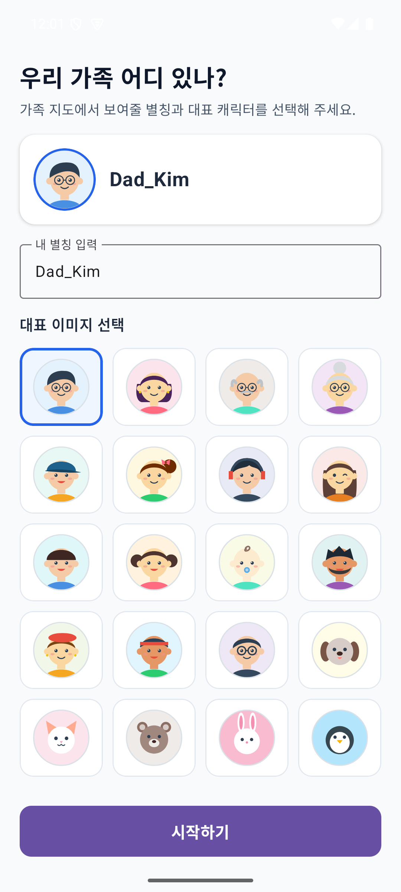
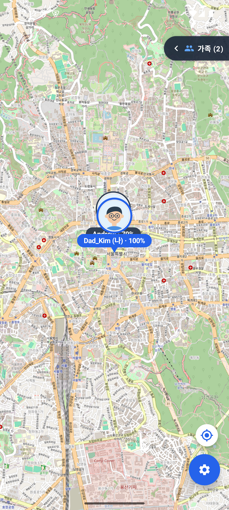
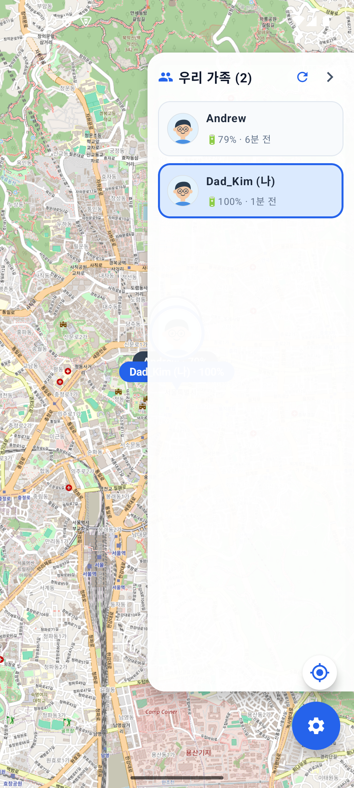
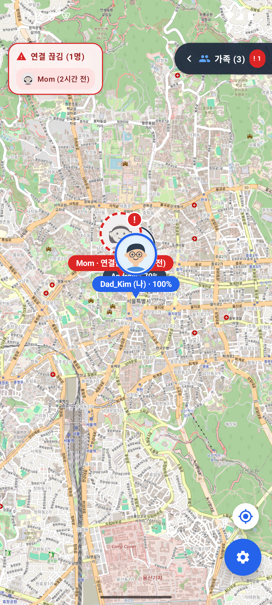
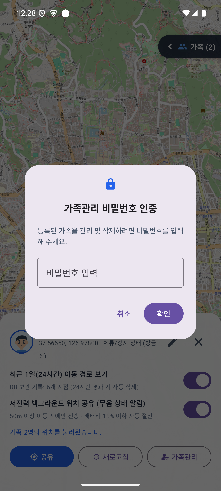
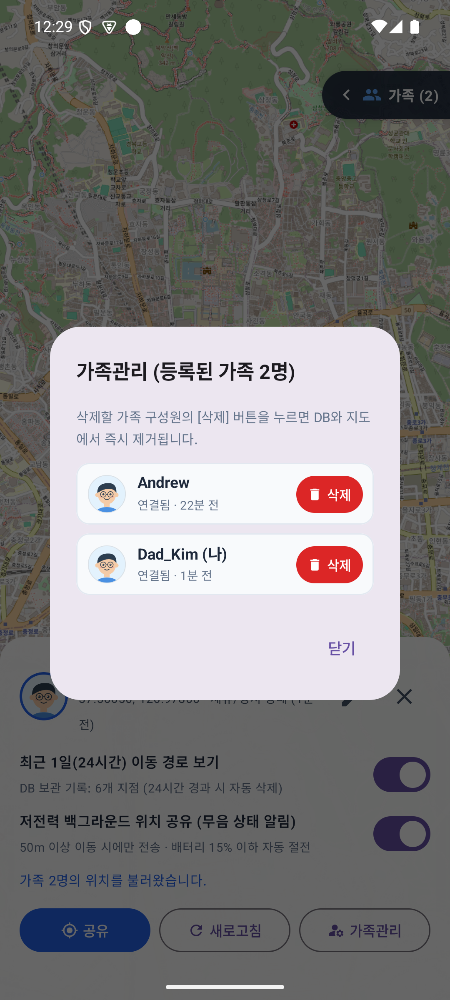

# 우리 가족 어디 있나? (Family Point)

<p align="center">
  
</p>

**우리 가족 어디 있나 (Family Point)**는 가족 구성원의 스마트폰에 설치하여 서로의 현재 위치와 최근 1일(24시간) 이동 경로를 오픈스트리트맵(OpenStreetMap) 위에서 실시간으로 확인할 수 있는 안드로이드 앱입니다.

- **빌드된 릴리즈 APK**: [`familyPoint.apk`](./familyPoint.apk)
- **상세 기획 및 아키텍처 설계서**: [`DESIGN.md`](./DESIGN.md)
- **Supabase DB 스키마 스크립트**: [`supabase_schema.sql`](./supabase_schema.sql)

---

## 주요 기능

1. **간편한 별칭 및 대표 아바타(20종) 선택**
   - 복잡한 회원가입이나 가족 코드 입력 없이 **내 별칭**과 **20종의 자체 제작 캐릭터 아바타**만 선택하면 즉시 가족 그룹에 연결됩니다.
2. **전체 화면 오픈스트리트맵(OSMDroid) & 커스텀 아바타 마커**
   - 별도의 유료 지도 API 키 없이 동작하며, 상·하단 가림 없는 전체 화면 지도 위에 각 가족의 **아바타 얼굴 + 별칭 + 배터리 잔량(%)** 커스텀 마커와 **최근 24시간 이동 경로(`Polyline`)**를 표시합니다.
3. **우측 슬라이드 가족 목록 & 플로팅 설정 시트**
   - 우측 상단의 `< 가족 (N)` 탭을 눌러 가족 목록을 우측에서 열고 닫을 수 있으며, 가족을 터치하면 해당 위치로 지도 카메라가 즉시 이동합니다.
   - 우측 하단의 톱니바퀴(설정) 아이콘을 누르면 하단 설정 시트(`공유`, `새로고침`, `가족관리`, `24시간 경로 보기`, `백그라운드 공유 스위치`)가 열립니다.
4. **연결 끊김(Offline) 가족 즉시 인지**
   - 위치 정보가 없거나 마지막 갱신 후 **35분 이상 경과**한 가족은 지도 마커가 **흑백 + 빨간 점선 링 + `!` 경고 배지 + `연결끊김` 라벨**로 바뀌며, 지도 좌측 상단에 **`⚠️ 연결 끊김` 플로팅 배너**가 자동으로 표시됩니다.
5. **앱 종료 후에도 유지되는 저전력 백그라운드 위치 전송**
   - 앱 최초 실행 직후부터 백그라운드 공유가 기본 활성화되며, 최근 실행 목록(Recents)에서 앱을 스와이프해 종료하거나 재부팅하더라도 `ForegroundService(stopWithTask="false")` + `PendingIntent BroadcastReceiver` + `WorkManager` 3중 복구 구조로 위치 전송을 지속합니다.
   - 30m 델타 필터링 및 배터리 15% 이하 자동 절전 모드로 배터리와 데이터 사용량을 최소화합니다.
6. **Supabase 1일치(24시간) 데이터 자동 보관 정책**
   - 위치 보고 시 단일 RPC(`report_location`) 호출과 `pg_cron` 스케줄러를 통해 **24시간이 지난 위치 이력 데이터를 DB에서 자동 삭제**합니다.
7. **비밀번호 인증 기반 가족관리 (가족 삭제)**
   - 설정 시트의 `가족관리` 버튼 클릭 후 고정 비밀번호(`family`)를 입력하면 등록된 가족 구성원을 DB와 지도에서 즉시 삭제할 수 있습니다.

---

## 주요 화면 캡처

| 1. 별칭 및 20종 아바타 선택 | 2. 전체 화면 지도 (기본) | 3. 우측 슬라이드 가족 목록 |
| :---: | :---: | :---: |
|  |  |  |

| 4. 연결 끊김 가족 지도 감지 | 5. 가족관리 비밀번호(`family`) 인증 | 6. 가족관리 (등록 가족 삭제) |
| :---: | :---: | :---: |
|  |  |  |

---

## 기술 스택 및 프로젝트 구조

- **Language & UI**: Kotlin 2.0, Jetpack Compose (Material 3), Edge-to-Edge WindowInsets 적용
- **Map SDK**: OpenStreetMap (`org.osmdroid:osmdroid-android:6.1.18`)
- **Location & Background**: Google Play Services `FusedLocationProviderClient`, `ForegroundService` (`IMPORTANCE_LOW`), `BroadcastReceiver`, `WorkManager`
- **Backend / Database**: Supabase (`PostgREST`, `PL/pgSQL RPC`, `pg_cron`), `OkHttp` + `kotlinx.serialization`

```text
family_point/
├── app/
│   └── src/main/
│       ├── AndroidManifest.xml
│       ├── java/com/familypoint/app/
│       │   ├── MainActivity.kt              # 권한 요청 및 온보딩/지도 화면 호스팅
│       │   ├── data/
│       │   │   ├── SupabaseRepository.kt    # Supabase REST/RPC 연동 및 1일치 이력 관리
│       │   │   └── UserPreferences.kt       # 단말 설정 및 30m 델타 필터링 저장소
│       │   ├── model/
│       │   │   ├── AvatarCatalog.kt         # 20종 대표 아바타 매핑 카탈로그
│       │   │   └── Models.kt                # 직렬화 데이터 모델
│       │   ├── service/
│       │   │   ├── LocationHelper.kt        # 저전력 위치 측정 및 배터리 상태 유틸
│       │   │   ├── LocationSyncService.kt   # stopWithTask=false 영속 포그라운드 서비스
│       │   │   ├── LocationUpdatesReceiver.kt # 프로세스 종료 대응 PendingIntent 리시버
│       │   │   ├── LocationSyncWorker.kt    # WorkManager 주기적 위치 동기화 워커
│       │   │   └── BootCompletedReceiver.kt # 재부팅/자가복구 브로드캐스트 리시버
│       │   └── ui/
│       │       ├── MainViewModel.kt         # 상태 관리 및 위치/가족관리 비즈니스 로직
│       │       ├── OnboardingScreen.kt      # 별칭 입력 및 20종 아바타 선택 화면
│       │       ├── MapScreen.kt             # 전체화면 지도, 우측 드로어, 설정/가족관리 UI
│       │       └── MarkerIconFactory.kt     # 커스텀 아바타 마커 및 연결끊김 배지 렌더러
│       └── res/
│           ├── drawable/                    # avatar_01~20.xml 및 앱 아이콘 벡터 리소스
│           └── mipmap-anydpi-v26/           # Adaptive Icon 설정
├── assets/                                  # 20종 SVG 원본, 프리뷰 HTML, 화면 캡처 이미지
├── DESIGN.md                                # 기획 및 상세 설계 문서
├── supabase_schema.sql                      # Supabase DB 초기화 및 권한 설정 SQL
└── familyPoint.apk                          # 서명된 Release APK 파일
```

---

## 설치 및 빌드 방법

### 1. Supabase DB 초기 설정
Supabase 프로젝트의 **SQL Editor**에서 [`supabase_schema.sql`](./supabase_schema.sql) 스크립트를 실행하여 테이블(`family_groups`, `family_members`, `location_history`), RPC 함수(`report_location`), 1일치 자동 삭제 스케줄러 및 권한(`GRANT`)을 생성합니다.

### 2. APK 바로 설치
루트 경로에 빌드된 [`familyPoint.apk`](./familyPoint.apk)를 안드로이드 스마트폰에 복사하여 설치하거나 ADB로 설치합니다.
```bash
adb install -r familyPoint.apk
```

### 3. 소스에서 Release APK 빌드
```bash
./gradlew assembleRelease
```
